# API Shortage & Competitor Recall Commercial Trigger

**An n8n + GenAI workflow that turns public FDA recall and drug-shortage signals into sized, supply-safe spot-buy pitches for GPO key-account managers, in under a day instead of a week.**

   

> Portfolio project by **Banibrata** (Business Analyst, Health & Life Sciences). All company, account, inventory, pricing and FDA records in this repository are **fictitious** and exist for demonstration only.

---

## 1. Executive summary

**The problem.** When a competitor recalls a generic injectable, or an active pharmaceutical ingredient (API) disruption puts a molecule on the FDA shortage list, hospitals and IDNs scramble for backup supply. The manufacturer that responds first, with a credible quantity and a fair price, wins the business and often the next GPO award. In most commercial teams this response is manual: an analyst reads the weekly FDA Enforcement Report, decodes NDCs by hand, checks ERP stock, sizes the deal in Excel and emails sales. That takes days, and quantities are often promised without protecting existing GPO contracts, which creates **Failure-to-Supply (FTS)** penalty risk.

**The solution.** A daily n8n workflow that:

1. Polls the **openFDA Enforcement** and **Drug Shortages** APIs.
2. Filters to Class I/II, ongoing events that touch our active portfolio *before* any AI spend.
3. Uses an **LLM Information Extractor** with a strict JSON schema to pull molecule, strength, NDCs (normalized to the HIPAA **11-digit 5-4-2** format) and **2-letter USPS state codes** from free text.
4. Passes every LLM output through a **deterministic QA gate** (grounding check, NDC rebuild + regex, USPS whitelist). The LLM proposes; code decides.
5. Matches the signal to **ERP inventory** and competitor-held **GPO account demand** in the affected states.
6. Sizes the opportunity with BA rules: **spot price = WAC − 12%**, after holding a **15% FTS safety buffer** on contract commitments.
7. Sends a **Slack pitch** to the owning key-account managers only when **net revenue ≥ $50,000**, and logs every decision for audit and de-duplication.

---

## 2. To-Be process architecture

```mermaid
flowchart LR
    T(["Daily schedule<br/>06:30 ET"]) --> W["Build 7-day<br/>query window"]
    W --> PF[("ERP: active<br/>portfolio molecules")]

    subgraph INGEST["1 · Ingest public signals"]
        E["openFDA<br/>Enforcement API"] --> S["openFDA<br/>Drug Shortages API"]
        S --> N["Normalize + pre-filter<br/>Class I/II · ongoing · in portfolio"]
    end

    subgraph AI["2 · AI extraction + controls"]
        L["LLM Information Extractor<br/>strict JSON schema · temperature 0"]
        Q{"Deterministic QA gate<br/>grounding · NDC 5-4-2 regex · USPS"}
        L --> Q
    end

    subgraph DECIDE["3 · Commercial decision"]
        M[("Match ERP inventory<br/>+ GPO account demand")]
        B["BA sizing<br/>WAC − 12% · 15% FTS buffer"]
        R{"Net revenue<br/>≥ $50k?"}
        M --> B --> R
    end

    subgraph ACT["4 · Action + audit"]
        SL["Slack pitch<br/>to key-account managers"]
        LOG[("Decision log<br/>audit + de-dup")]
        QZ[("QA quarantine<br/>human review")]
    end

    PF --> E
    N -->|"relevant events only"| L
    Q -->|"pass"| M
    Q -->|"fail"| QZ
    R -->|"yes"| SL --> LOG
    R -->|"no"| LOG

    classDef ai fill:#EDE7F6,stroke:#5E35B1,color:#1a1a1a
    classDef control fill:#FFF3E0,stroke:#EF6C00,color:#1a1a1a
    classDef data fill:#E3F2FD,stroke:#1565C0,color:#1a1a1a
    classDef action fill:#E8F5E9,stroke:#2E7D32,color:#1a1a1a
    class L ai
    class Q,R control
    class PF,M,LOG,QZ data
    class SL action
```



**As-Is vs To-Be in one line:** an analyst-driven weekly scan with email hand-offs becomes a daily, rules-governed pipeline where people only review exceptions and approve pricing.

---

## 3. Business impact & KPIs

| KPI | Manual review (As-Is) | n8n automation (To-Be) | Impact |
|---|---|---|---|
| **Signal-to-pitch lead time** | 3–5 business days (weekly report read, manual NDC + ERP lookups, email chain) | **< 24 hours** (next 06:30 ET run; minutes of processing) | **~75–90% faster** response to competitor stock-outs |
| **Failure-to-Supply buffer protection** | Ad hoc; spot quantities judged deal by deal | **100%** of opportunities sized after a **15% buffer** on GPO-committed volume | Contracted customers protected by design; FTS penalty exposure reduced |
| **Analyst hours** | ~6 hrs/week reading recalls, decoding NDCs, sizing in Excel | ~1 hr/week reviewing the QA quarantine queue | **~5 hrs/week (~250 hrs/yr)** returned to analysis |
| **NDC data quality** | Hand transcription; mixed 10/11-digit formats | Every NDC rebuilt by rule, regex-validated (5-4-2) and grounded in the source text | Ambiguous NDCs quarantined, never guessed |
| **Portfolio coverage** | Class I recalls on top molecules (bandwidth-limited) | All Class I/II recalls + current shortages across the full active portfolio | No missed signals on long-tail SKUs |
| **Pitch qualification** | Gut feel | Consistent rule: net revenue **≥ $50k** at WAC − 12% | Sales time spent on material deals only |
| **Auditability** | Emails and spreadsheets | Every decision, input and QA note logged in `shortage_opportunity_log` | Defensible pricing and allocation decisions |

> **How to read these numbers.** Baselines are modeled from a typical manual workflow and are illustrative, not measured results from a live deployment. In an interview, present them as the business case and the KPIs you would baseline and track after go-live.

---

## 4. What a demo run produces

The two openFDA nodes ship with **pinned mock data**, so a manual *Test workflow* run is reproducible. Running it against the seeded database gives:

| FDA signal (mock) | QA gate | Commercial outcome |
|---|---|---|
| **Cisplatin 1 mg/mL** recall, Class II, nationwide (NDC 5-3-2 format) | Pass, normalized to 5-4-2 | **SKU-CIS-100: $74,695.60 → Slack pitch** to 4 accounts. SKU-CIS-050: $2,659.80, below threshold (the FTS buffer leaves only 132 spot vials) |
| **Albuterol 2.5 mg/3 mL** recall, Class I, "CA, NV, AZ, OR and Washington" (4-4-2) | Pass; "Washington" → `WA` | **$78,234.00 → Slack pitch** to 4 western accounts. TX account excluded (outside footprint); OR account excluded (already our contract) |
| **Carboplatin 10 mg/mL** on the FDA shortage list (5-4-1) | Pass | **SKU-CARB-045: $69,795.00 → Slack pitch.** SKU-CARB-005: FTS-protected, 0 spot units |
| **Methotrexate** recall with NDC printed as `5512345678` | **Quarantined:** an unhyphenated 10-digit NDC is ambiguous | Logged for human review; no pitch |
| **Lidocaine 1%** shortage of *our own* NDC | Pass | No pitch: own-labeler guard |
| Atorvastatin (not in portfolio), Fluorouracil (Class III), Isocarboxazid | Filtered **before** the LLM | No AI spend |

**Result:** 3 pitches worth **$222,724.60** in estimated net spot revenue, 1 quarantine, 0 risk to contracted supply. A second run the next day sends **no duplicate pitches**.

---

## 5. Key design decisions (the BA lens)

- **LLM proposes, code decides.** The model handles messy free text; deterministic code owns every number and identifier. The NDC is rebuilt by rule from the raw string and the LLM's version is only compared (mismatches are logged as `LLM_NDC_CORRECTED`, a live accuracy metric). In testing, a simulated LLM padding error (`68123-05502-1`) was caught and corrected to `68123-5502-01`.
- **Grounding check.** If the "raw" NDC the LLM returns does not appear verbatim in the FDA text, the record is quarantined, which blocks hallucinated identifiers.
- **Match on molecule + strength, not NDC.** A competitor's NDC identifies *their* product. Our substitute is found by therapeutic equivalence, while the competitor NDC is kept for audit and for the own-labeler guard.
- **FTS buffer on commitments.** `protected = committed × 1.15`. During a competitor stock-out our *own* contracted customers surge too, so the buffer protects them first.
- **Price below WAC by design.** Spot price is WAC − 12%, never a premium, which keeps the program clear of shortage price-gouging concerns.
- **Target the right accounts.** Only `SECONDARY` / `NOT_AWARDED` accounts in the affected states are spot targets; `AWARDED` accounts are already inside committed volume.
- **Human in the loop.** Slack goes to internal KAMs, not customers. Each message asks for Pricing & Contracts approval and the MLR-approved shortage template before outreach.
- **Cost guardrail.** A cheap portfolio pre-filter and a 40-event cap per run keep LLM spend proportional to relevance.

---

## 6. Repository structure

```text
.
├── README.md                                   ← you are here
├── 01_business_requirements/
│   └── BRD_Commercial_Trigger.md               ← formal BRD: FRs, business rules, UAT, traceability
├── 02_n8n_workflows/
│   └── pharma_recall_commercial_trigger.json   ← importable n8n workflow (with demo pin data)
└── 03_database_schema/
    └── schema.sql                              ← PostgreSQL schema + realistic mock data
```

---

## 7. Quick start

**Prerequisites:** n8n (Cloud or self-hosted, a recent 1.x release or later with the AI/LangChain nodes), a PostgreSQL 13+ database (local Docker, Supabase or Neon all work), an Anthropic or OpenAI API key and a Slack workspace.

1. **Create the database**
   ```bash
   psql "$DATABASE_URL" -f 03_database_schema/schema.sql
   ```
2. **Import the workflow.** In n8n: *Workflows → Import from File →* `02_n8n_workflows/pharma_recall_commercial_trigger.json`.
3. **Attach credentials.**
   - **Postgres:** the four Postgres nodes (Load Portfolio, Match ERP, Log QA Quarantine, Log Opportunity Decision).
   - **LLM:** *Anthropic Chat Model* (set to `claude-haiku-5-5`; pick any current model from the list). To use OpenAI instead, delete it, add an **OpenAI Chat Model** sub-node and connect it to the extractor's *Model* port with temperature 0.
   - **Slack:** a bot token with `chat:write`. Invite the bot to `#gpo-shortage-alerts`, or choose another channel in the Slack node.
4. **Run the demo.** Click **Test workflow**. Expect 3 Slack messages and the rows above in `shortage_opportunity_log`:
   ```sql
   SELECT * FROM v_opportunity_pipeline;
   ```
5. **Go live.** Toggle the workflow **Active**. Scheduled runs ignore pinned data and call the live openFDA API (2 keyless requests per day). To reset the demo, re-run `schema.sql`.

### Tunable business parameters

| Parameter | Default | Where |
|---|---|---|
| Spot discount vs WAC | 12% | `BA Spot-Buy Sizing` → `CFG.SPOT_DISCOUNT_PCT` |
| FTS safety buffer | 15% of committed units | `BA Spot-Buy Sizing` → `CFG.FTS_BUFFER_PCT` |
| Months of demand to size | 1 | `BA Spot-Buy Sizing` → `CFG.MONTHS_OF_COVER` |
| Pitch threshold | $50,000 net | `CFG.MIN_NET_REVENUE_USD` **and** the `Net Revenue ≥ $50k?` If node |
| Look-back window | 7 days | `Build Query Window` → `LOOKBACK_DAYS` |
| Max events sent to LLM per run | 40 | `Normalize & Pre-Filter Events` → `MAX_EVENTS_PER_RUN` |
| Schedule | 06:30 America/New_York daily | `Daily Schedule Trigger` |

---

## 8. Limitations & roadmap

- openFDA enforcement data follows FDA's weekly report cadence, so "daily" means detection within a day of *publication*, not of the recall itself.
- The FDA shortage feed has no geography, so shortage signals are treated as nationwide.
- Demand comes from a flattened account × SKU view; production would read CRM and chargeback (EDI 867) data directly.
- **Next:** add ASHP shortage data and "To Be Discontinued" listings, write accepted pitches back to the CRM, and add a Looker/Power BI view on `shortage_opportunity_log` to track win rate and realized revenue against forecast.

---

## 9. Disclaimer

This is a portfolio demonstration. It is not medical, legal or pricing advice, and it is not affiliated with or endorsed by the FDA. openFDA data is provided without validation and should not be used for clinical decisions. Any real deployment needs review by Pricing, Legal/Compliance and MLR.

---

**Author:** Banibrata · Business Analyst, Health & Life Sciences · GenAI and Agentic AI in pharma
<!-- Replace with your profile link: [LinkedIn](https://www.linkedin.com/in/your-profile) -->
