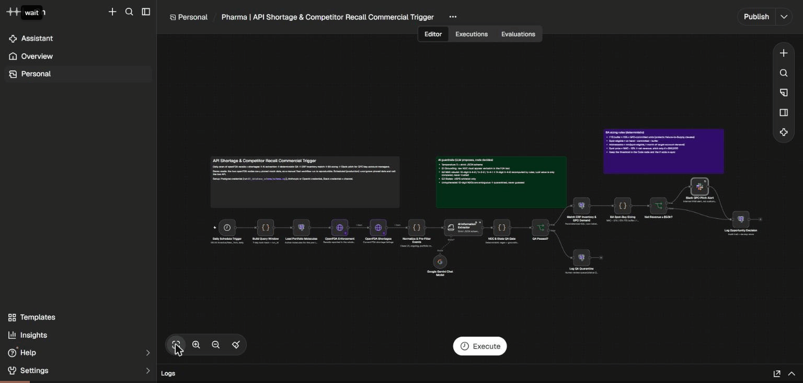
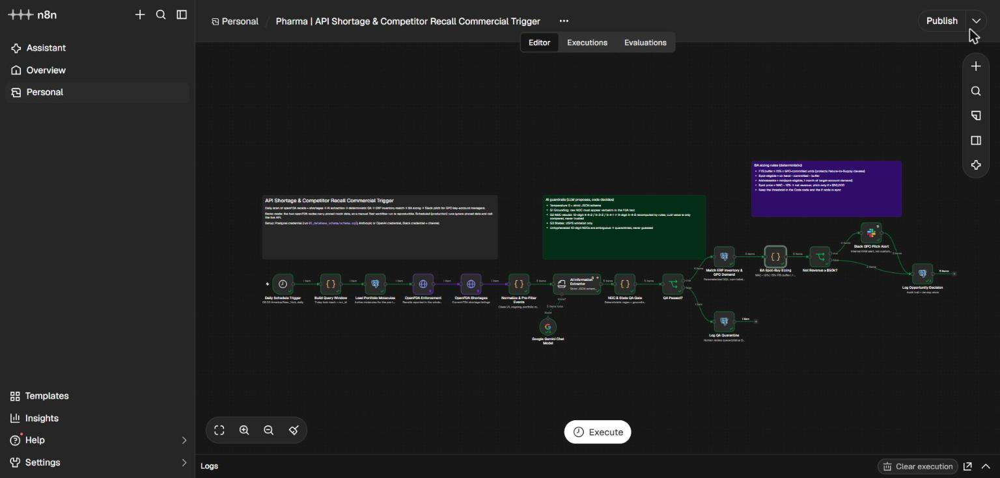
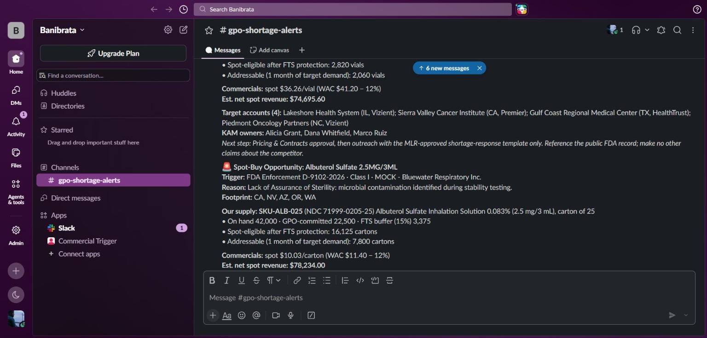
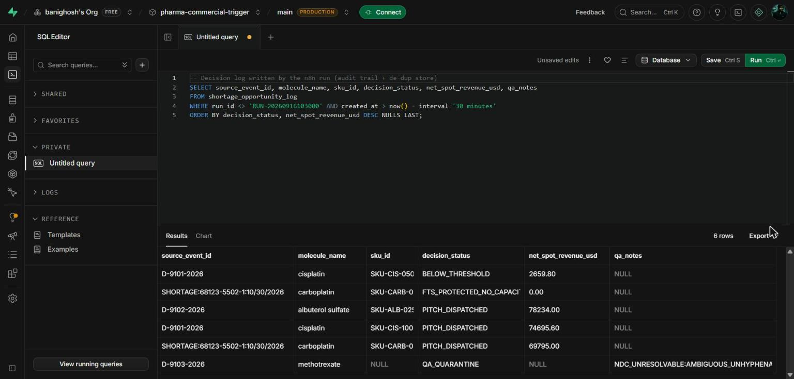

# Demo & Presentation Guide

A recorded end-to-end run of the workflow, plus a talk track for presenting it in an interview or portfolio review. Everything shown uses **fictitious mock data**.

*The recording: n8n runs the workflow → Slack receives the GPO pitches → the decision log lands in PostgreSQL (Supabase).*

---

## What the run shows

| Step | What happens | Where it's visible |
|---|---|---|
| 1 | Daily trigger builds a 7-day window and loads the 8 active portfolio molecules | n8n canvas, first nodes turn green |
| 2 | openFDA Enforcement + Shortages return 8 records; 5 survive the deterministic pre-filter | `Normalize & Pre-Filter Events` → "5 items" |
| 3 | The LLM (Google Gemini) extracts molecule, strength, NDCs and USPS states into strict JSON | `AI Information Extractor` |
| 4 | QA gate rebuilds every NDC to 5-4-2, checks grounding and states; the ambiguous methotrexate NDC is quarantined | `QA Passed?` → 4 true / 1 false |
| 5 | SQL matches competitor signals to our SKUs and to competitor-held GPO accounts in the affected states; our own lidocaine shortage is skipped | `Match ERP Inventory & GPO Demand` |
| 6 | BA sizing applies the 15% FTS buffer and WAC − 12%; 3 SKUs clear the $50k bar | `Net Revenue ≥ $50k?` → 3 true / 2 false |
| 7 | 3 pitches post to `#gpo-shortage-alerts`; every decision is logged | Slack + Supabase |

### Results

| SKU | Decision | Est. net spot revenue |
|---|---|---|
| SKU-ALB-025 · Albuterol 2.5 mg/3 mL | **Pitch sent** (CA, NV, AZ, OR, WA) | **$78,234.00** |
| SKU-CIS-100 · Cisplatin 1 mg/mL, 100 mL | **Pitch sent** (nationwide) | **$74,695.60** |
| SKU-CARB-045 · Carboplatin 10 mg/mL, 45 mL | **Pitch sent** (FDA shortage list) | **$69,795.00** |
| SKU-CIS-050 · Cisplatin 1 mg/mL, 50 mL | Below threshold: buffer leaves 132 spot vials | $2,659.80 |
| SKU-CARB-005 · Carboplatin 10 mg/mL, 5 mL | FTS-protected: 0 spot units after buffer | $0.00 |
| Methotrexate (D-9103-2026) | QA quarantine: unhyphenated 10-digit NDC | n/a |

### Screenshots

**Workflow after the run (every node green)**

**GPO pitches delivered to Slack**

**Decision log in PostgreSQL (audit trail + de-dup store)**

---

## 3-minute talk track

**1. Hook (15 s)**
"When a competitor recalls a generic injectable, hospitals need backup supply within days. The manufacturer that answers first, with a safe quantity and a fair price, wins the business. I automated that response."

**2. Problem (30 s)**
"Today an analyst reads the weekly FDA report, decodes NDCs by hand, checks ERP stock and emails sales. It takes 3 to 5 days, and quantities get promised without protecting existing GPO contracts, which creates Failure-to-Supply penalty risk."

**3. Architecture (30 s)** *(show the Mermaid diagram in the README)*
"Four stages: ingest public openFDA signals, AI extraction with deterministic controls, commercial decision against ERP and GPO data, then a Slack action plus an audit log."

**4. Live run (60 s)** *(play the GIF or click Execute in n8n)*
- "Eight FDA records come in. A cheap rules filter keeps the five that touch our portfolio, so we don't pay for AI on irrelevant records."
- "The LLM turns free text into structured JSON: molecule, strength, NDC, states."
- "Then the key design choice: **the LLM proposes, code decides.** The QA gate rebuilds every NDC by rule, checks it appears verbatim in the FDA text, and validates states. This methotrexate NDC is printed without hyphens, so it's ambiguous. It goes to human review, not to sales."
- "Sizing is pure code: hold 15% above contract commitments, price at WAC minus 12%, pitch only above $50k. Three opportunities qualify: about $223k in a single run."

**5. Guardrails & compliance (20 s)**
"No LLM touches a number. Pricing is below WAC by design, so there's no shortage gouging. Slack goes to internal KAMs only, with an MLR-approved template step. We never pitch against our own shortage, and never pitch twice."

**6. Impact (15 s)**
"Lead time drops from days to under 24 hours, roughly 250 analyst hours a year come back, and every decision is auditable. These are modeled targets I'd baseline after go-live."

---

## Questions you're likely to get

| Question | Crisp answer |
|---|---|
| Why use an LLM at all? | FDA recall text is unstructured: NDCs, strengths and states are buried in prose. The LLM handles parsing; code owns every decision. |
| How do you stop hallucinations? | Temperature 0, strict schema, the raw NDC must appear verbatim in the source, the NDC-11 is recomputed by rule, a USPS whitelist, and fail-closed quarantine. |
| Why match on molecule + strength, not NDC? | A competitor's NDC identifies *their* product. Our substitute is found by therapeutic equivalence; the competitor NDC is kept for audit and the own-labeler guard. |
| Why a 15% buffer on commitments, not on inventory? | During a competitor stock-out our contracted customers surge too. The buffer protects the volume FTS clauses cover. |
| What if the AI is down? | The extractor continues on error; affected events are quarantined and logged, nothing reaches Sales, and the next daily run retries. |
| How would this scale in production? | CRM + chargeback (EDI 867) data for demand, ASHP and "To Be Discontinued" feeds, CRM write-back for win/loss, and a BI view on the decision log. |

---

## Running it live (checklist)

1. **Reset the demo data** so pitches post fresh (the workflow never pitches the same event twice): run `03_database_schema/schema.sql` again.
2. Open the workflow in n8n and click **Execute workflow**. The openFDA nodes use pinned demo data for manual runs.
3. Allow about 2 minutes. With the Gemini free tier, each AI extraction takes 15–30 s.
4. Show Slack `#gpo-shortage-alerts`, then run `SELECT * FROM v_opportunity_pipeline;` for the audit view.
5. Close any tab that shows API keys or tokens before you share your screen.

**Tested configuration (Nov 2026):** n8n self-hosted, Google Gemini 3.5 Flash Lite (free tier, temperature 0) as the extractor model, Supabase PostgreSQL via the session pooler, Slack bot with `chat:write` posting to a channel set by ID.

---

© 2026 Banibrata. All rights reserved. See [LICENSE](../LICENSE).
